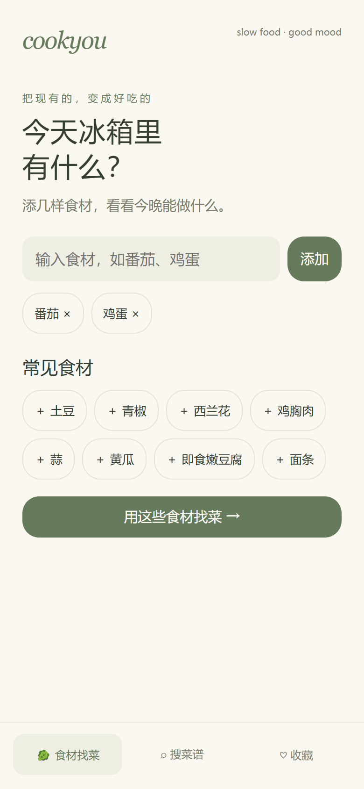
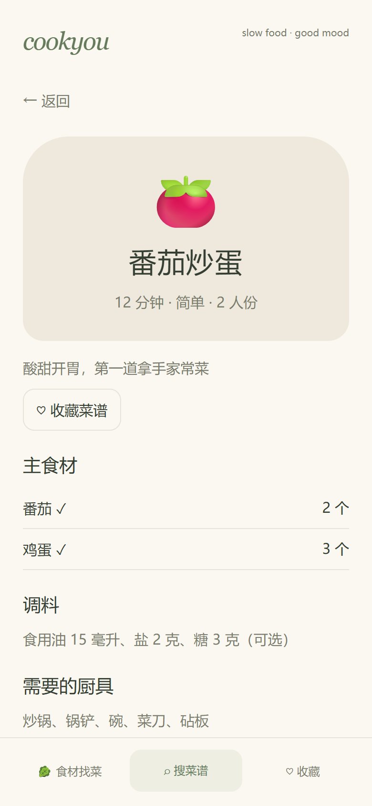

# cookyou

**冰箱里有什么，今天就做什么。**

cookyou 是一款轻松、简单的 Android 离线食谱 App。输入手上已有的食材，看看能做哪些菜；也可以直接搜菜名，一次找到食材用量、厨具和分步教程。

奶油色背景、鼠尾草绿和柔和圆角，让做饭像翻一本自己的料理手账。

## 下载体验

前往 [Releases](https://github.com/Scdxg/cookyou/releases/latest) 下载 APK。支持 **Android 8.0 及以上**。

当前版本 **0.1.3**，安装包采用调试签名，供体验测试使用。已在一台 Android 手机上完成安装与启动检查，完整真机交互和多机型兼容性仍待验证。

## 功能

- **食材找菜**：输入多种食材，按缺少主食材的数量排列结果。
- **缺少食材提示**：区分主食材齐全与需要补充食材的菜谱。
- **菜名搜索**：直接搜索想吃的菜。
- **30 道家常菜**：炒菜、汤、粥、面和蒸菜，附用量、调料和厨具。
- **分步跟做**：一步一步看做法，支持前后切换。
- **本地收藏**：食材和收藏保存在手机本机。

不需要注册或联网，不申请网络、相机或通讯录权限。清除应用数据或卸载会移除本地收藏。

## 界面预览

 

## 项目结构

- `app/src/main/assets/index.html`：界面、交互与实际内置菜谱。
- `app/src/main/java/com/cookyou/app/`：Android Activity 与本地页面加载。
- `data/recipes.json`：30 道菜谱的数据副本。
- `docs/`：截图与版本说明。

当前采用 Android WebView 加载 APK 内置页面，无远程服务依赖。菜谱为项目内整理的示例，尚未逐道实厨验证；时间为估算，需按食材厚度、设备与实际熟度调整。

## 本地构建

准备 JDK 17、Android SDK Platform 35 Extension 15、Build Tools 35.0.0。可使用 Android Studio 打开项目并安装 SDK。

在未跟踪的 `local.properties` 中设置本机 SDK 路径：

```properties
sdk.dir=/your/android/sdk
```

Windows：

```powershell
.\gradlew.bat :app:assembleDebug :app:lintDebug
```

macOS / Linux：

```bash
chmod +x gradlew
./gradlew :app:assembleDebug :app:lintDebug
```

安装包输出到 `app/build/outputs/apk/debug/app-debug.apk`。首次构建需联网下载 Gradle 和依赖；仓库不包含签名密钥。Windows 也可运行 `./build-apk.ps1` 将安装包复制到 `dist/`。

## 交互检查

需要 Node.js 与 Playwright Chromium：

```bash
npm install
npx playwright install chromium
npm test
```

可设置 `COOKYOU_BROWSER_CHANNEL=msedge` 使用本机 Edge。检查覆盖食材匹配、搜索、详情、收藏持久化、分步做菜、同义食材、320/390/600 像素布局等交互。

## 作者
 [Scdxg](https://github.com/Scdxg)

欢迎通过 [Issues](https://github.com/Scdxg/cookyou/issues) 反馈问题或提出想加入的菜谱。
